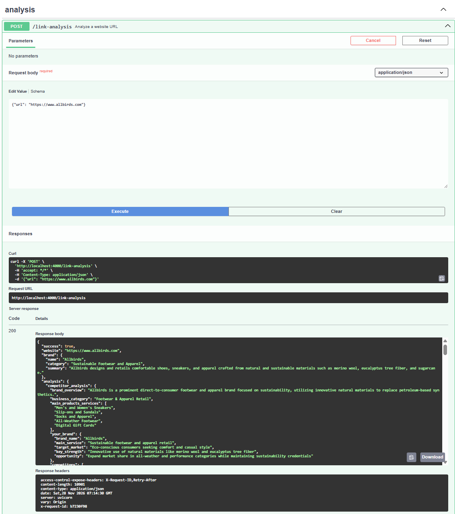
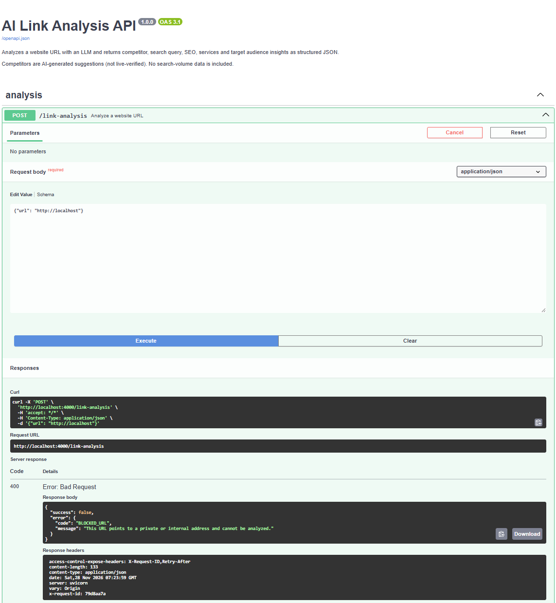
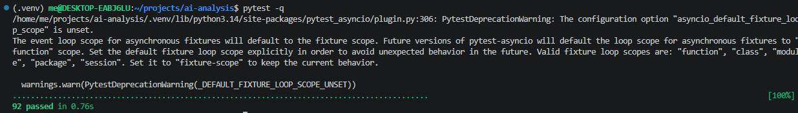

# ai-link-analysis

FastAPI service that analyzes any website URL with an LLM and returns competitor, search query, SEO, services and audience insights as structured JSON.

**Live demo:** https://ai-link-analysis.onrender.com  
**API endpoint:** `POST https://ai-link-analysis.onrender.com/link-analysis`  
**API docs:** https://ai-link-analysis.onrender.com/docs  

---

## How it works

```text
URL -> validate (format + SSRF) -> safe fetch (manual redirects, each hop re-checked)
    -> HTML cleanup -> single LLM call -> Pydantic validation (1 repair, fallback model)
    -> post-processing -> JSON response
```

1. **Validation & SSRF Protection:** Validates scheme (`http`/`https`) and ports (80/443). Blocks private, loopback, link-local, cloud metadata, NAT64, and 6to4 IP addresses.
2. **Safe Multi-Page Fetching:** Connects using `httpx`, manually follows redirects (max 3), re-verifying SSRF on every hop. Fetches homepage plus up to 2 high-value sub-pages (e.g., `/services`, `/about`).
3. **HTML Cleanup & Budgeting:** Strips noise (scripts, styles, tracking tags, cookie/GDPR containers) and deduplicates text within a strict character budget (`MAX_CONTENT_CHARS = 12000`).
4. **Single-Call Structured LLM Generation:** Sends prompt with a compact JSON template. Supports Gemini, OpenAI, and Anthropic. Validates with Pydantic v2 with automatic single-repair retry and model fallback.
5. **Post-Processing & Caching:** Sanitizes competitor sites, enforces SEO title/description constraints, attaches operational metadata, and caches in-memory with single-flight request deduplication.

---

## Setup & Running Locally

### Prerequisites
- Python 3.11+
- Git

### Installation
```bash
git clone https://github.com/Nakul443/ai-link-analysis.git && cd ai-link-analysis
python3 -m venv .venv && source .venv/bin/activate   # Windows: .venv\Scripts\activate
pip install -r requirements.txt
cp .env.example .env    # Configure your LLM_API_KEY and model IDs
uvicorn app.main:app --host 0.0.0.0 --port 4000 --reload
```

- **Interactive API Docs:** [http://localhost:4000/docs](http://localhost:4000/docs)
- **Health Check:** `curl http://localhost:4000/health`
- **Run Tests:** `pytest -q` (92 unit & integration tests)

---

## Configuration

All configuration is managed via environment variables (see `.env.example`). Changing providers requires **zero code changes**:

```env
# App
APP_ENV=development
APP_HOST=0.0.0.0
APP_PORT=4000
LOG_LEVEL=INFO

# LLM Configuration (supports: gemini | openai | anthropic)
LLM_PROVIDER=gemini
LLM_API_KEY=your_api_key_here
LLM_MODEL=gemini-3.5-flash-lite
LLM_FALLBACK_MODEL=gemini-3.8-flash
LLM_MAX_OUTPUT_TOKENS=8192
LLM_TEMPERATURE=0.2
LLM_TIMEOUT_SECONDS=60
LLM_MAX_RETRIES=2

# Fetching & Content Budget
FETCH_TIMEOUT_SECONDS=15
FETCH_MAX_BYTES=2000000
FETCH_MAX_REDIRECTS=3
MAX_CONTENT_CHARS=12000
EXTRA_PAGES_MAX=2

# Cache & Rate Limiting
CACHE_TTL_SECONDS=3600
CACHE_MAX_ENTRIES=200
RATE_LIMIT_PER_MINUTE=6
MAX_CONCURRENT_ANALYSES=2
ANALYSIS_TIMEOUT_SECONDS=120
TRUST_PROXY=false
CORS_ORIGINS=http://localhost:5173,http://localhost:3000
```

---

## Sample Request & Response

### Request
```bash
curl -X POST http://localhost:4000/link-analysis \
  -H "Content-Type: application/json" \
  -d '{"url":"https://www.allbirds.com"}'
```

### Response (Trimmed)
```json
{
  "success": true,
  "website": "https://www.allbirds.com",
  "brand": {
    "name": "Allbirds",
    "category": "Sustainable Footwear and Apparel",
    "summary": "Allbirds designs and manufactures comfortable shoes, sneakers, slip-ons, and apparel using natural and sustainable materials like merino wool, eucalyptus tree fiber, and sugarcane-based SweetFoam."
  },
  "analysis": {
    "competitor_analysis": {
      "brand_overview": "Allbirds is a prominent eco-friendly lifestyle brand known for pioneering sustainable footwear using natural and renewable materials, catering to everyday consumers seeking comfort and minimal environmental impact.",
      "business_category": "Direct-to-Consumer Footwear and Apparel",
      "main_products_services": [
        "Men's and Women's Sneakers",
        "Slip-ons and Canvas Shoes",
        "All-Weather Footwear",
        "Socks and Apparel",
        "Digital Gift Cards"
      ],
      "your_brand": {
        "brand_name": "Allbirds",
        "main_service": "Sustainable Everyday Footwear",
        "target_market": "Eco-conscious consumers and urban commuters looking for comfortable, lightweight footwear.",
        "key_strength": "Proprietary sustainable materials like TENCEL Lyocell, merino wool, and SweetFoam sugarcane midsoles.",
        "opportunity": "Expand the casual lifestyle and weather-resistant footwear lines while growing corporate bulk gifting."
      },
      "competitors": [
        {
          "brand_name": "Rothy's",
          "website": "https://www.rothys.com",
          "main_service": "Sustainable shoes and bags made from recycled plastic bottles",
          "target_market": "Eco-conscious urban professionals and women seeking stylish washable shoes",
          "key_strength": "Zero-waste manufacturing process and machine-washable products",
          "opportunity": "Target men's market segment more aggressively where Allbirds holds stronger footing",
          "strengths": [
            "Machine washable products",
            "Strong appeal in women's footwear",
            "Zero-waste knitting technology"
          ],
          "weaknesses": [
            "Higher price point",
            "Less diverse men's collection"
          ],
          "source": "ai_suggested"
        },
        {
          "brand_name": "Vans",
          "website": "https://www.vans.com",
          "main_service": "Casual sneakers and skateboarding shoes",
          "target_market": "Youth, skateboarders, and casual wear enthusiasts",
          "key_strength": "Massive brand heritage and iconic design recognition",
          "opportunity": "Shift consumer perception toward sustainable alternatives like Allbirds canvas options",
          "strengths": [
            "Iconic timeless designs",
            "Massive global retail distribution",
            "Affordable pricing"
          ],
          "weaknesses": [
            "Slower adoption of truly sustainable, high-tech natural materials",
            "Less focus on ergonomic everyday comfort technology"
          ],
          "source": "ai_suggested"
        },
        {
          "brand_name": "On Running",
          "website": "https://www.on.com",
          "main_service": "High-performance running shoes and athletic apparel",
          "target_market": "Runners, athletes, and athleisure consumers",
          "key_strength": "Advanced CloudTec cushioning technology and premium athletic performance",
          "opportunity": "Compete more directly in the high-performance running category",
          "strengths": [
            "Strong technical performance credentials",
            "High brand loyalty among runners",
            "Strong premium positioning"
          ],
          "weaknesses": [
            "Higher price points",
            "Less focus on casual everyday natural-fiber lifestyle shoes"
          ],
          "source": "ai_suggested"
        }
      ],
      "competitive_advantages": [
        "Use of innovative natural materials such as eucalyptus tree fiber and merino wool",
        "Proprietary sugarcane-based SweetFoam cushioning providing responsive energy return",
        "Strong commitment to regenerative agriculture and responsible energy sourcing",
        "Lightweight, breathable, and travel-friendly shoe construction"
      ],
      "positioning_opportunities": [
        "Position products as the ultimate travel and commuting shoe for modern professionals",
        "Emphasize the intersection of high comfort and zero-compromise environmental sustainability",
        "Expand corporate gifting solutions for eco-conscious businesses"
      ]
    },
    "target_search_queries": [
      {
        "query": "most comfortable everyday walking sneakers",
        "platforms": [
          "Google"
        ],
        "intent": "High commercial intent to purchase comfortable daily footwear",
        "business_relevance": "Directly matches Allbirds' core product value proposition for sneakers like the Tree Runner",
        "target_audience": "Urban commuters and travelers looking for ergonomic comfort"
      },
      {
        "query": "best sustainable shoes made from natural materials",
        "platforms": [
          "Instagram"
        ],
        "intent": "Discovery and visual inspiration for eco-friendly fashion",
        "business_relevance": "Highlights Allbirds' unique selling point of using eucalyptus, wool, and sugarcane",
        "target_audience": "Eco-conscious millennials and Gen Z shoppers"
      },
      {
        "query": "breathable slip on shoes for travel",
        "platforms": [
          "Facebook"
        ],
        "intent": "Local and community discovery for practical travel gear",
        "business_relevance": "Aligns with Allbirds' slip-on and cruiser collections optimized for travel",
        "target_audience": "Vacationers and frequent flyers"
      },
      {
        "query": "corporate eco friendly employee holiday gifts bulk",
        "platforms": [
          "LinkedIn"
        ],
        "intent": "B2B inquiry for company gifting and perks",
        "business_relevance": "Targets the digital gift card and bulk purchasing offerings for businesses",
        "target_audience": "HR managers and corporate gifting coordinators"
      },
      {
        "query": "sustainable fashion brand updates 2024",
        "platforms": [
          "X"
        ],
        "intent": "Following industry news and brand sustainability milestones",
        "business_relevance": "Engages tech-forward and eco-conscious conversation topics regarding green business",
        "target_audience": "Sustainability advocates and industry observers"
      }
    ],
    "seo_improvements": {
      "primary_keyword": "comfortable sustainable shoes",
      "secondary_keywords": [
        "eco friendly sneakers",
        "merino wool shoes",
        "eucalyptus tree sneakers",
        "lightweight travel shoes"
      ],
      "long_tail_keywords": [
        "most comfortable shoes for walking and travel",
        "mens breathable tree runner sneakers",
        "womens washable casual slip on shoes",
        "sustainable shoes made from natural materials",
        "eco friendly digital gift cards for business"
      ],
      "business_keywords": [
        "Allbirds",
        "SweetFoam",
        "Tree Runner NZ",
        "Terralux Collection",
        "TENCEL Lyocell"
      ],
      "recommended_title": "Allbirds: Comfortable Sustainable Shoes & Eco-Friendly Sneakers",
      "title_structure": "[Brand]: [Primary Benefit] [Product Category] & [Secondary Benefit]",
      "meta_description": "Discover Allbirds, the world's most comfortable sustainable shoes made from natural materials like merino wool and eucalyptus. Shop eco-friendly sneakers today.",
      "supporting_content": [
        {
          "type": "service_landing_page",
          "title": "Terralux Collection Overview",
          "rationale": "Highlights Allbirds' premium new collection designed for enhanced style and everyday wear."
        },
        {
          "type": "industry_page",
          "title": "Sustainable Materials and Regenerative Agriculture",
          "rationale": "Explains the science and sourcing behind eucalyptus, merino wool, and SweetFoam to build trust."
        },
        {
          "type": "faq",
          "title": "Allbirds Shoe Care and Washing Guide",
          "rationale": "Addresses common customer inquiries regarding the maintenance of natural fiber footwear."
        }
      ]
    },
    "top_services": [
      {
        "name": "Men's and Women's Sneakers",
        "description": "Everyday lightweight sneakers crafted from breathable TENCEL Lyocell tree fiber and merino wool.",
        "target_industry": "Footwear and Retail",
        "target_customer": "Urban commuters, walkers, and everyday consumers",
        "main_benefit": "All-day ergonomic comfort with a lightweight, breathable feel",
        "source": "website"
      },
      {
        "name": "Slip-ons and Canvas Shoes",
        "description": "Easy-to-wear slip-on footwear like the Canvas Cruiser designed for effortless casual styling.",
        "target_industry": "Footwear and Retail",
        "target_customer": "Travelers and casual weekend wearers",
        "main_benefit": "Convenient slip-on design with zero-hassle wearability",
        "source": "website"
      },
      {
        "name": "Digital Gift Cards",
        "description": "Instant digital vouchers available in multiple balances and bulk options for corporate gifting.",
        "target_industry": "Corporate Gifting and Retail",
        "target_customer": "Gift-givers and HR professionals looking for eco-friendly rewards",
        "main_benefit": "Flexible, zero-plastic gifting solution with instant email delivery",
        "source": "website"
      }
    ],
    "target_audience": {
      "primary_audience": [
        "Eco-conscious urban consumers",
        "Frequent travelers and commuters",
        "Individuals prioritizing foot comfort and ergonomics"
      ],
      "secondary_audience": [
        "Gift shoppers",
        "Corporate HR and wellness managers",
        "Athleisure fashion enthusiasts"
      ],
      "industries": [
        "Retail and E-commerce",
        "Travel and Tourism",
        "Corporate Sustainability"
      ],
      "business_types": [
        "Direct-to-Consumer (D2C) Retail",
        "Corporate Gifting Partners"
      ],
      "customer_profiles": [
        "The Urban Commuter looking for lightweight, breathable shoes for walking to work",
        "The Conscious Shopper seeking brands with verified sustainable supply chains",
        "The Practical Traveler needing versatile, easy-to-pack footwear"
      ],
      "geographic_focus": null,
      "customer_needs": [
        "Exceptional all-day comfort and cushioning",
        "Sustainable products with low carbon footprints",
        "Breathable materials that prevent heat buildup",
        "Easy online shopping with reliable shipping and returns"
      ],
      "customer_interests": [
        "Sustainable living and eco-friendly products",
        "Casual streetwear and athleisure fashion",
        "Travel, outdoor exploration, and active lifestyles"
      ],
      "recommended_segments": [
        {
          "audience": "Urban Commuters",
          "business_type": "Direct-to-Consumer",
          "requirement": "Lightweight sneakers with responsive cushioning for daily walking."
        }
      ]
    }
  },
  "meta": {
    "provider": "gemini",
    "model_used": "gemini-3.5-flash-lite",
    "input_tokens": 2463,
    "output_tokens": 2546,
    "pages_analyzed": 1,
    "cached": false,
    "processing_ms": 16500,
    "warnings": [
      "Competitors are AI-generated suggestions from general knowledge and have not been verified against live sources."
    ]
  }
}
```

Full raw JSON samples are available in [`docs/samples/`](docs/samples/).

## Screenshots





---

## Error Handling

All API errors return a standard `ErrorResponse` structure:
```json
{
  "success": false,
  "error": {
    "code": "BLOCKED_URL",
    "message": "This URL points to a private or internal address and cannot be analyzed."
  }
}
```

| HTTP Status | Error Code | Description |
|---|---|---|
| `400` | `INVALID_URL` | Malformed URL, unsupported scheme (must be http/https), or bad port |
| `400` | `BLOCKED_URL` | SSRF attempt (private IP, loopback, cloud metadata, link-local) |
| `400` | `HOST_NOT_RESOLVED` | DNS lookup failed |
| `400` | `INVALID_REQUEST` | Missing `url` in JSON body or unparseable JSON |
| `404` | `NOT_FOUND` | Route does not exist |
| `405` | `METHOD_NOT_ALLOWED` | Incorrect HTTP method |
| `422` | `SITE_ACCESS_RESTRICTED` | Target website returned 401, 403, or 429 |
| `422` | `UNSUPPORTED_CONTENT` | Non-HTML content (PDF, image, audio, etc.) |
| `422` | `INSUFFICIENT_CONTENT` | Page has insufficient text (empty or client-rendered SPA) |
| `429` | `RATE_LIMITED` | Too many requests per IP (returns `Retry-After` header) |
| `502` | `SITE_UNREACHABLE` | Could not connect to site or encountered redirect loop |
| `502` | `LLM_INVALID_RESPONSE` | Model output was not valid JSON or failed schema validation |
| `503` | `LLM_UNAVAILABLE` | AI service is temporarily down or rate-limited |
| `504` | `SITE_TIMEOUT` / `LLM_TIMEOUT` | Website or LLM request exceeded timeout limit |
| `500` | `INTERNAL_ERROR` | Unexpected server failure |

---

## Security

- **Strict SSRF Guard:** Enforces `http` or `https` on ports 80 and 443 only. Resolves hostnames and validates that *every* returned IP address is a publicly routable global IP. Blocks `localhost`, `metadata.google.internal`, `.local`, `.internal`, IPv4-mapped IPv6, NAT64 (`64:ff9b::/96`), and 6to4 (`2002::/16`).
- **Manual Redirect Auditing:** Redirects are disabled in HTTP client and handled explicitly hop-by-hop. Every intermediate redirect target is re-validated through the SSRF check.
- **Prompt Injection Defense:** Web content is wrapped in `<website_content>` tags, closing tags inside extracted content are stripped, and the system prompt explicitly commands the model to treat content as untrusted data and ignore embedded instructions.
- **Secret Safety:** API keys are injected exclusively through environment variables. Keys are never printed in logs, error payloads, or responses.

---

## Honesty Notes & Grounding Constraints

- **Competitors are AI Suggestions:** Competitors are labeled with `source="ai_suggested"`. Because the model does not browse the live web, competitor entries represent AI-generated market suggestions based on general knowledge and are never presented as verified live data.
- **Service Grounding:** Services are explicitly marked as `source="website"` only when confirmed by the page content, or `source="inferred"` when recommended by the LLM.
- **Zero Hallucinated Metrics:** No search volumes, traffic figures, CPCs, or ranking scores are included because no live SEO index is integrated.

---

## LLM Research & Model Comparison (Summary)

Candidate models evaluated for cost, latency, token consumption, and structured output reliability:

| Provider | Model (API ID) | Input / Output ($ per 1M) | Context / Max Output | JSON Mode | Free API Tier |
|---|---|---|---|---|---|
| Google | `gemini-3.5-flash-lite` | $0.30 / $2.50 | 1M / 64K | Native JSON Mode | Yes (available in AI Studio) |
| Google | `gemini-3.8-flash` | $0.75 / $3.75 | 1M / 64K | Native JSON Mode | Listed in AI Studio (introductory until 2026-12-31, then 1.50/7.50) |
| OpenAI | `gpt-5.6-luna` | $0.20 / $1.20 | 1.05M / 128K | Structured Outputs | Pricing only, not measured |
| Anthropic | `claude-haiku-5-5` | $0.10 / $0.50 | 1M / 128K | Prompt + Validation | Pricing only, not measured |

### Measured Benchmark Runs
Tested via `scripts/benchmark.py` across `https://basecamp.com`, `https://thoughtbot.com`, and `https://www.allbirds.com`:

**Run 1 (Initial Run):**
| Model | Runs | Success | Single call | Median s | Mean s | Avg in tok | Avg out tok | $/analysis | $/analysis (2027 price) | Title <=60 | Meta <=160 | 5/5 platforms | >=3 competitors | Services grounded |
|---|---|---|---|---|---|---|---|---|---|---|---|---|---|---|
| gemini-3.5-flash-lite | 3 | 33% | 100% | 16.5 | 16.5 | 2463 | 2546 | $0.0071 | $0.0071 | 0% | 100% | 100% | 100% | 40% |

**Run 2 (Retry Run under Load):**
| Model | Runs | Success | Single call | Median s | Mean s | Avg in tok | Avg out tok | $/analysis | $/analysis (2027 price) | Title <=60 | Meta <=160 | 5/5 platforms | >=3 competitors | Services grounded |
|---|---|---|---|---|---|---|---|---|---|---|---|---|---|---|
| gemini-3.5-flash-lite | 3 | 0% | n/a | n/a | n/a | n/a | n/a | n/a | n/a | n/a | n/a | n/a | n/a | n/a |

*Note: Title <=60 is checked on raw model output; the API trims titles to 60 chars. Failures were mostly Google 503 overload. n=3 sites, indicative only.*

**Final Recommendation:**
- **Primary:** `gemini-3.5-flash-lite` (the model validated and runnable on the free tier).
- **Fallback:** `gemini-3.8-flash` (separate quota bucket).
- **Scale Pick:** For commercial high-volume deployment, `claude-haiku-5-5` or `gpt-5.6-luna` reduces token costs by ~7.5x and ~2.3x respectively.

Full research, cost breakdown, and human scoring rubric: [docs/LLM_RESEARCH.md](docs/LLM_RESEARCH.md) and [docs/accuracy_scoring.md](docs/accuracy_scoring.md).

---

## Known Limitations

1. **No JavaScript Rendering:** Sites requiring heavy client-side JavaScript execution (SPAs) will return `INSUFFICIENT_CONTENT` errors. This is documented and by design to prevent headless browser resource exhaustion.
2. **In-Memory Cache & Limiter:** The default TTL cache and sliding-window rate limiter are stored in-process. Suitable for single-instance deployments; a Redis backend is recommended for distributed horizontal scaling.
3. **DNS Rebinding Window:** There is an inherent minor time-of-check to time-of-use (TOCTOU) gap between DNS validation and HTTP fetching.

